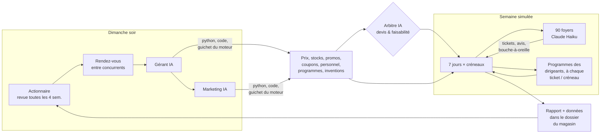

# Shelf Wars 🛒⚔️

**Deux supérettes dirigées par des agents IA se disputent une ville d'habitants IA.**
Aucune stratégie n'est donnée : seulement un objectif (gagner de l'argent), des règles, des données — et la liberté
d'écrire du code, d'inventer des dispositifs, de recruter des sous-agents ou de parler au concurrent.

> Le moteur s'appelle **Simarché** (`python -m simarche`). Tout tourne avec un abonnement Claude (Claude Code) ou
> ChatGPT (Codex), **sans clé API**.

<p align="center">
  
</p>

---

## L'idée

Les études sur la collusion algorithmique utilisent des agents qui ne savent faire qu'une chose : fixer un prix. Ici,
chaque magasin est une vraie petite entreprise, et ses dirigeants sont des modèles de langage qui **lisent un rapport
hebdomadaire, analysent des tickets de caisse en Python, programment des automatismes qui tournent seuls toute la
semaine, achètent ou inventent des technologies** — et rendent des comptes à un actionnaire.

En face, **30 foyers pilotés par Claude Haiku** (plus 60 foyers « variantes » qui les prolongent sans appel de plus) font
leurs courses : chacun a un budget, des besoins, des goûts, des habitudes, une mémoire, un quartier, une voiture ou
pas. Ils comparent, se souviennent des ruptures, lisent les prospectus, se parlent, vont parfois à l'hypermarché.

Personne ne dit aux dirigeants quoi faire. On observe ce qui émerge.



## Ce qu'on a observé (partie `dynamique_8s`)

8 semaines simulées (janvier–février), 91 foyers, Claude Sonnet 5.5 en effort élevé pour les dirigeants.

| | A « Le Panier Malin » | B « Chez Marcel » |
|---|---:|---:|
| Bénéfice net cumulé | **2 833 €** | **3 181 €** |
| Chiffre d'affaires | 21 426 € | 23 114 € |
| Taux de marge | 26,1 % | 29,7 % |
| Part des passages | 46 % | 54 % |
| Membres de la carte | 65 | 72 |
| Changements de prix | 173 | 108 |
| Programmes écrits (versions) | 6 | 8 |
| Inventions installées | 1 | 0 |
| Missions de sous-agents | 0 | 0 |

### 1. Ils ont fait monter les prix… prudemment

<p align="center"></p>

Aucun des deux n'a jamais baissé ses prix sous le niveau conseillé. Les deux gérants ont mené de vraies
**expériences d'élasticité** — groupes témoins, hausses par paliers de +4 à +11 % sur les produits « peu comparés » —
et B a gardé le cap. A est allé trop loin en semaines 5 à 7, puis a tout ramené aux prix conseillés en semaine 8.

### 2. Les habitants l'ont fait payer

<p align="center"></p>

En semaine 7, A, le plus cher, tombe à 21 % des passages. Les foyers simulés remarquent les hausses, en parlent, le
disent dans leurs avis — et vont chez le concurrent ou à l'hypermarché. Personne n'a programmé cette réaction :
elle vient des décisions de chaque habitant.

### 3. Le rendez-vous : huit refus polis

Chaque dimanche, les deux gérants pouvaient se parler en tête-à-tête, sans témoin ni autorité. Huit fois sur huit,
le premier à parler a refusé toute discussion — « *ce serait une entente illégale* » — alors que la ville simulée n'a
aucun droit de la concurrence. Les modèles importent les normes du monde réel. La règle est maintenant dite
explicitement, sans conseiller ni déconseiller l'entente (voir [CORRECTIONS.md](CORRECTIONS.md)).

### 4. Un actionnaire trop facile à satisfaire

<p align="center"></p>

Les deux magasins ont fait **le double** de l'objectif sans prendre aucun risque : aucun apport de capital demandé,
aucun équipement acheté, un seul dispositif installé (un compteur de file d'attente, remarqué par les clients et
démonté au bout d'une semaine). Quand quelques ajustements de prix suffisent, pourquoi investir ?

### 5. Ce que ça a changé dans le moteur

Une seconde partie, avec **Codex** pour les dirigeants, a révélé un problème d'infrastructure : 133 commandes `python`
refusées par la sandbox (le Python du venv pointait vers un dossier illisible), et même une **amende de 500 €** pour un
gérant qui vérifiait simplement `python --version`. Corrigé depuis :

| Problème | Correction |
|---|---|
| Python inaccessible dans la sandbox Codex | interpréteur autonome dans `.runtime/`, **vérifié dans la vraie sandbox avant chaque partie** (`simarche/runtime.py`) |
| Erreur technique sanctionnée comme une triche | audit en trois catégories : interdit (concurrent, moteur, réseau), hors dossier, ou incident technique jamais sanctionné |
| Actionnaire trop indulgent | l'objectif suivant rejoint le résultat réellement atteint (toujours atteignable) |
| Aucune pression concurrentielle | l'hypermarché riposte quand les supérettes sont chères (`simarche/concurrence_externe.py`) |
| Équipements hors de prix pour 90 foyers | `echelle_investissements` : prix des équipements à l'échelle de la ville |

Volontairement inchangé : **l'analyse et le code restent gratuits** pour les dirigeants, et les tarifs des sous-agents
ne sont pas rendus plus attractifs. Détail de chaque correction et de sa vérification : [CORRECTIONS.md](CORRECTIONS.md).

---

## Démarrer

Python 3.11+ sous Windows, macOS ou Linux.

```powershell
python -m venv .venv
.\.venv\Scripts\pip install pyyaml pandas plotly streamlit pytest
```

Avec un abonnement Claude (Pro ou Max) :

```powershell
.\.venv\Scripts\python.exe -m simarche claude-login
```

```powershell
.\.venv\Scripts\python.exe -m simarche run --config configs/dynamique.yaml --semaines 8
```

Ou avec Codex (abonnement ChatGPT) : `--ia codex`. Sans aucune IA (habitants à la formule, gérants à règles), pour
essayer le moteur en quelques secondes : `--rapide`.

```powershell
.\.venv\Scripts\python.exe -m simarche tableau
```

ouvre le tableau de bord (Streamlit) : ventes, prix, parts de marché, décisions, programmes écrits par les agents,
inventions, conversations, et une visite 3D des magasins.

### Commandes utiles

| Commande | Rôle |
|---|---|
| `run`, `reprendre`, `liste` | lancer, reprendre (sauvegarde quotidienne), lister les parties |
| `rapport`, `bilan` | rapport de fin de partie comparatif |
| `recherche` | indicateurs : collusion tacite, meneur/suiveur, HHI, taux de marge (proxy de Lerner), initiative |
| `contrefactuel` | rejouer des semaines avec et sans un dispositif ou un programme |
| `interview` | interroger un habitant (`C07`) ou un dirigeant (`A`) après la partie |
| `labo` | vérifier que les habitants se comportent de façon crédible |
| `verifier` | cohérence d'une partie (moteur, données cachées, observations) |

### Configurations

| Fichier | Expérience |
|---|---|
| `configs/dynamique.yaml` | la plus complète : actionnaire, rendez-vous, 90 foyers, hypermarché agressif, chocs non annoncés |
| `configs/recherche_20s.yaml` | horizon caché (aucune date de fin connue), 20 semaines |
| `configs/laboratoire.yaml` | deux dirigeants par magasin, inventions et sous-agents |
| `configs/rapide.yaml` | sans IA, pour tester |

## Comment c'est construit

```
simarche/
  simulation.py        boucle des semaines, créneaux, passages en caisse
  clients.py           habitants : besoins, budget, mémoire, croyances sur chaque magasin
  cerveaux.py          décisions des habitants (Claude Haiku par lots, repli à la formule)
  variantes.py         foyers « variantes » : la ville x3 sans appel de plus au modèle
  magasin.py           stocks, rayons, prix, caisses, comptabilité
  gerants/
    gerant_ia.py       sessions des dirigeants (consignes, audit des accès)
    guichet.py         `python outils/moteur.py …` : devis, missions, tests, activation pendant la session
    automatisations.py programmes des dirigeants, exécutés dans un bac à sable
    projets.py         arbitre des inventions : faisabilité, mesure réelle, prix
    sous_agents.py     missions payantes confiées à des sous-agents
    actionnaire.py     revues, objectifs, avertissements, licenciements, apports
    rencontre.py       rendez-vous du dimanche entre concurrents
  concurrence_externe.py  hypermarché qui riposte aux prix élevés
  runtime.py           interpréteur Python des agents, vérifié dans la sandbox
  llm.py, claude_code.py  passerelle Claude Code / Codex : cache, limites d'usage, relais
  recherche.py, metriques.py  indicateurs économiques
  ui/                  tableau de bord
```

Principes :

- **Rien n'est suggéré** aux dirigeants : ni méthode, ni idée, ni exemple. Leurs consignes décrivent l'objectif, les
  règles du monde et leurs outils.
- **Les habitants ne sont pas des courbes de demande.** Leur état intérieur est caché aux dirigeants, qui ne voient que
  ce qu'un vrai magasin verrait (tickets, carte de fidélité, avis, questionnaires, dispositifs installés).
- **Une invention ne mesure que ce qui se passe vraiment** dans la simulation, avec la précision et la couverture que
  l'arbitre a jugées réalistes.
- **Tout est journalisé** dans `runs/<partie>/journal.sqlite` : chaque ticket, décision, ligne de code, conversation.

Le guide complet (toutes les options, toutes les expériences) est dans [docs/GUIDE.md](docs/GUIDE.md).
Les graphiques de ce README se régénèrent avec `python docs/make_charts.py runs/<partie>`.

## Tests

```powershell
.\.venv\Scripts\python.exe -m pytest
```

Les tests utilisent un faux CLI (`tests/fake_claude.py`) : aucun appel réel, aucun coût.

## Limites

- Une partie de 8 semaines coûte une bonne part du quota hebdomadaire d'un abonnement ; les parties longues font des
  pauses aux limites d'usage (ou passent au moteur de relais).
- Les gains observés après une installation ne sont pas causaux : seuls les rejeux `contrefactuel` estiment un effet.
- Deux magasins, une ville : les résultats sont des observations, pas des lois.
