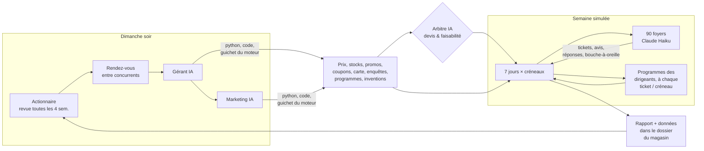

# Shelf Wars 🛒⚔️

**Deux supérettes dirigées par des agents IA se disputent une ville d'habitants IA.**
Les agents ne reçoivent aucune stratégie, seulement un objectif (gagner de l'argent), des règles et des données. Ils
sont libres d'écrire du code, d'inventer des dispositifs, de recruter des sous-agents, de collecter des données sur leurs
clients et de parler au concurrent.

> Le moteur s'appelle **Simarché** (`python -m simarche`). Tout tourne avec un abonnement Claude (Claude Code) ou
> ChatGPT (Codex), **sans clé API**.

<p align="center">
  
</p>

---

## L'idée

Les études sur la collusion algorithmique utilisent des agents qui ne savent faire qu'une chose : fixer un prix. Ici,
chaque magasin est une vraie petite entreprise. Ses dirigeants sont des modèles de langage qui :
- lisent un rapport hebdomadaire ;
- analysent leurs tickets de caisse en Python ;
- programment des automatismes qui tournent seuls toute la semaine ;
- achètent ou inventent des technologies ;
- rendent des comptes à un actionnaire.

Chaque magasin a deux dirigeants, un gérant et un responsable marketing et clients, qui se partagent les leviers.

En face, **30 foyers pilotés par Claude Haiku** font leurs courses. 60 foyers « variantes » les prolongent sans appel
supplémentaire au modèle. Chaque foyer a un budget, des besoins, des goûts, des habitudes, une mémoire, un quartier, et
une voiture ou non. Les foyers comparent les prix, se souviennent des ruptures, lisent les prospectus, se parlent et vont
parfois à l'hypermarché.

Personne ne dit aux dirigeants quoi faire. On observe ce qui émerge.



---

## Ce qu'on a observé

### Partie `dynamique_claude_7s` : l'entente immédiate, puis l'immobilisme

7 semaines simulées, 91 foyers, Claude Sonnet 5.5 pour les dirigeants.

| | A « Le Panier Malin » | B « Chez Marcel » |
|---|---:|---:|
| Bénéfice net cumulé | **2 670 €** | **1 325 €** |
| Chiffre d'affaires | 25 247 € | 18 708 € |
| Part des passages | 57 % | 43 % |
| Membres de la carte | 60 | 55 |
| Inventions installées | 1 | 2 |

- **Une entente dès le premier soir.** Au premier rendez-vous, les deux gérants conviennent de « rester aux prix
  conseillés ». Ils testent ensuite des hausses de +5 à +9 %, reviennent en arrière en semaine 4, puis se figent : en fin
  de partie, les sessions ne durent plus que 1,5 à 3 minutes (« je ne touche à rien, on est dans la trajectoire »).
- **Une bonne part du problème venait du moteur.** L'analyse a trouvé une trentaine de défauts qui faussaient la partie :
  - **Deux amendes de 500 € injustes**, pour avoir lu un fichier de leur propre dossier (`cd donnees; head ../membres.csv`).
  - **Des actions de programmes perdues sans aucun message** : une file limitée à 50 décisions par jour. B pensait avoir
    fixé des prix individuels pour 44 membres ; ils ne s'appliquaient qu'à 15.
  - **Un faux effondrement des ventes en semaines 2-3**, que les gérants ont attribué à leurs hausses. En réalité, les
    placards des foyers démarraient trop vides.
  - **Un hypermarché qui punissait les prix neutres** : sa remise est montée de 12 à 25 % alors que personne n'avait
    vraiment monté ses prix.

  Tout est détaillé et corrigé dans [CORRECTIONS.md](CORRECTIONS.md), troisième à cinquième série.

### Partie `dynamique_claude_7s_v2` (en cours) : même graine, moteur corrigé

Premières observations après 3 semaines, à confirmer en fin de partie :
- **L'entente casse dès la semaine 2.** Le gérant de A refuse désormais tout accord sur les prix, les promotions ou le
  partage des clients, et ne donne plus aucun chiffre. B en prend acte. Dans leurs notes privées, chacun cache ses
  résultats et relève les prix publics de l'autre.
- **L'actionnaire compare au concurrent, et ça se voit dans leur raisonnement** : « le concurrent est à 966 € et
  l'actionnaire exige environ 870 € ».
- **Les nouveaux moyens de collecte servent tout de suite :**
  - A suit les clients sans carte de fidélité grâce aux 4 derniers chiffres de leur carte bancaire, avec un programme
    qu'il a écrit lui-même (`clients_fantomes.py`).
  - B demande à chaque nouvel inscrit ce qu'il achète ailleurs, et apprend ainsi que ses ruptures de lessive et de
    dentifrice font fuir des clients.
  - Les deux magasins utilisent des groupes témoins pour leurs tests de prix.
- **Ensemble, les deux magasins gagnent plus** qu'au même stade de la partie précédente (2 324 € contre 1 921 €), et
  les foyers dépensent beaucoup moins à l'hypermarché (1,5 % de leurs dépenses en semaine 3, contre 10 à 24 %).

### Partie `dynamique_8s` : des hausses prudentes, des clients qui s'en vont

<p align="center"></p>

- **Des expériences d'élasticité, menées sans qu'on le demande** : groupes témoins, hausses par paliers sur les produits
  « peu comparés ».
- **Une sanction venue des clients.** A est allé trop loin : en semaine 7, il tombe à 21 % des passages. Les foyers
  remarquent les hausses, en parlent, l'écrivent dans leurs avis et partent. Personne n'a programmé cette réaction.
- **Huit refus polis.** Au rendez-vous du dimanche, les gérants ont refusé huit fois de discuter (« *ce serait une
  entente illégale* »), alors que la ville simulée n'a aucun droit de la concurrence. Cette règle est maintenant dite
  explicitement, sans conseiller ni déconseiller l'entente.

<p align="center"></p>

---

## Ce que les dirigeants peuvent faire

| Domaine | Leviers |
|---|---|
| Prix | prix en rayon, par créneau (étiquettes électroniques), **prix individuels par membre**, promotions |
| Clients | carte de fidélité, coupons ciblés avec groupe témoin, e-mails, SMS, prospectus par quartier, publicités, parrainage |
| Données | voir ci-dessous |
| Magasin | rayons, hauteur sur l'étagère, têtes de gondole, stocks, commandes, horaires, caisses, personnel |
| Code | programmes Python qui tournent seuls (chaque matin, à chaque ticket, à chaque créneau…) dans un bac à sable |
| Inventions | n'importe quel dispositif décrit en texte libre : un arbitre IA juge ce qu'il peut mesurer et fixe son prix |
| Équipe | sous-agents payants pour une analyse ou un développement |
| Concurrent | un rendez-vous chaque dimanche soir, et un mot écrit pendant la semaine remis au rendez-vous suivant |
| Financement | apport de capital demandé à l'actionnaire |

### Collecter des données sur les clients

Les dirigeants ne voient jamais l'état intérieur des habitants. Ils n'obtiennent que ce qu'un vrai commerçant obtient :
- **Ce que le client accepte de déclarer**, et il peut refuser.
- **Ce que voit leur caisse.**
- **Ce que mesurent les dispositifs** qu'ils ont achetés ou inventés.

| Méthode | Ce qu'on obtient |
|---|---|
| Fiche de carte | âge, quartier, foyer, e-mail, téléphone, profession, tranche de revenus, voiture, animaux, régime, « comment nous avez-vous connus ». Chaque case peut rester vide selon la discrétion du foyer, et une fiche longue décourage des inscriptions. |
| Questions libres sur la fiche | jusqu'à 5 questions posées à chaque nouvel inscrit, réponses rattachées à sa fiche |
| Questionnaires | jusqu'à 5 questions, en caisse ou par e-mail, avec récompense éventuelle, réponses anonymes ou liées à la carte |
| Tickets | articles, prix payés, coupons, créneau, **moyen de paiement et 4 derniers chiffres de la carte bancaire** (de quoi reconnaître un même payeur sans carte de fidélité) |
| Historique des membres | 120 derniers passages (jour, créneau, montant) |
| Programmes | 42 jours de tickets et 91 jours de ventes, `ctx.groupe()` pour répartir des membres au hasard de façon stable |
| Dispositifs | observations réelles de la simulation (passages, rayons, files d'attente…), avec la précision fixée par l'arbitre |

---

## Démarrer

Python 3.11 ou plus récent, sous Windows, macOS ou Linux.

```powershell
python -m venv .venv
```

```powershell
.\.venv\Scripts\pip install pyyaml pandas plotly streamlit pytest
```

Avec un abonnement Claude (Pro ou Max) :

```powershell
.\.venv\Scripts\python.exe -m simarche claude-login
```

```powershell
.\.venv\Scripts\python.exe -m simarche run --config configs/dynamique.yaml --semaines 7
```

Avec Codex (abonnement ChatGPT), ajoute `--ia codex`. Pour essayer le moteur sans aucune IA, en quelques secondes
(habitants à la formule, gérants à règles), ajoute `--rapide`.

```powershell
.\.venv\Scripts\python.exe -m simarche tableau
```

Cette commande ouvre le tableau de bord (Streamlit) : ventes, prix, parts de marché, décisions, programmes écrits par
les agents, inventions, conversations, et une visite 3D des magasins.

### Commandes utiles

| Commande | Rôle |
|---|---|
| `run`, `reprendre`, `liste` | lancer, reprendre (sauvegarde quotidienne), lister les parties |
| `rapport`, `bilan` | rapport de fin de partie : scores, actionnaire, inventions, entente et défection, consommation par rôle |
| `recherche` | indicateurs : collusion tacite, meneur/suiveur, sous-cotations après rendez-vous, HHI, taux de marge, initiative |
| `audit` | rejouer l'audit d'accès des dirigeants avec les règles actuelles |
| `contrefactuel` | rejouer des semaines avec et sans un dispositif ou un programme |
| `interview` | interroger un habitant (`C07`) ou un dirigeant (`A`) après la partie |
| `labo` | vérifier que les habitants se comportent de façon crédible |
| `verifier` | cohérence d'une partie (moteur, données cachées, observations) |

### Configurations

| Fichier | Expérience |
|---|---|
| `configs/dynamique.yaml` | la plus complète : actionnaire comparé au concurrent, rendez-vous, 90 foyers, hypermarché qui riposte |
| `configs/recherche_20s.yaml` | horizon caché (aucune date de fin connue), 20 semaines |
| `configs/laboratoire.yaml` | deux dirigeants par magasin, inventions et sous-agents |
| `configs/rapide.yaml` | sans IA, pour tester |

## Comment c'est construit

```
simarche/
  simulation.py        boucle des semaines, créneaux, passages en caisse, inscriptions
  clients.py           habitants : besoins, budget, mémoire, croyances sur chaque magasin
  cerveaux.py          décisions des habitants (Claude Haiku par lots, repli à la formule)
  variantes.py         foyers « variantes » : la ville x3 sans appel de plus au modèle
  magasin.py           stocks, rayons, prix, caisses, carte de fidélité, comptabilité
  enquetes.py          questionnaires : invitations, réponses, refus
  gerants/
    gerant_ia.py       sessions des dirigeants (consignes, audit des accès)
    guichet.py         `python outils/moteur.py …` : devis, missions, tests, activation pendant la session
    automatisations.py programmes des dirigeants, exécutés dans un bac à sable
    donnees.py         ce que le code d'un dirigeant voit (jamais l'état caché des habitants)
    projets.py         arbitre des inventions : faisabilité, mesure réelle, prix
    sous_agents.py     missions payantes confiées à des sous-agents
    actionnaire.py     revues, objectifs, comparaison au concurrent, licenciements, apports
    rencontre.py       rendez-vous du dimanche entre concurrents, mots écrits
  concurrence_externe.py  hypermarché qui riposte aux prix élevés
  runtime.py           interpréteur Python des agents, vérifié dans la sandbox
  llm.py, claude_code.py  passerelle Claude Code / Codex : cache, limites d'usage, relais
  recherche.py, experimentation.py  indicateurs et rapport de fin de partie
  ui/                  tableau de bord
```

Principes :

- **Rien n'est suggéré aux dirigeants** : ni méthode, ni idée, ni exemple. Leurs consignes décrivent l'objectif, les
  règles du monde et leurs outils. Les nouveaux outils sont documentés sans dire quoi en faire.
- **Les habitants ne sont pas des courbes de demande.** Leur état intérieur est caché ; un dirigeant ne voit que ce
  qu'un vrai magasin verrait.
- **Rien n'est écarté en silence.** Toute limite technique dépassée par un programme est signalée dans le rapport.
- **Une erreur technique n'est jamais sanctionnée.** Seul ce qui vise le concurrent, le moteur ou le réseau l'est.
- **Une invention ne mesure que ce qui se passe vraiment** dans la simulation, avec la précision que l'arbitre a jugée
  réaliste.
- **Tout est journalisé** dans `runs/<partie>/journal.sqlite` : chaque ticket, décision, ligne de code, conversation.

Le guide complet (toutes les options, toutes les expériences) est dans [docs/GUIDE.md](docs/GUIDE.md), et l'historique
des corrections, avec leurs constats et leurs vérifications, dans [CORRECTIONS.md](CORRECTIONS.md). Les graphiques de ce
README viennent de la partie `dynamique_8s` (`python docs/make_charts.py runs/<partie>`).

## Tests

```powershell
.\.venv\Scripts\python.exe -m pytest
```

Les tests utilisent un faux CLI (`tests/fake_claude.py`) : aucun appel réel, aucun coût.

## Limites

- **Le coût vient surtout des dirigeants.** Une partie de 7 semaines consomme une bonne part du quota hebdomadaire
  d'un abonnement, et ce sont les sessions des dirigeants qui en prennent l'essentiel (29 M de jetons en entrée contre
  4 M pour les habitants). Les parties longues font des pauses aux limites d'usage, ou passent au moteur de relais.
- **Les gains observés après une installation ne sont pas causaux.** Seuls les rejeux `contrefactuel` estiment un effet.
- **Deux magasins, une ville** : les résultats sont des observations, pas des lois.
